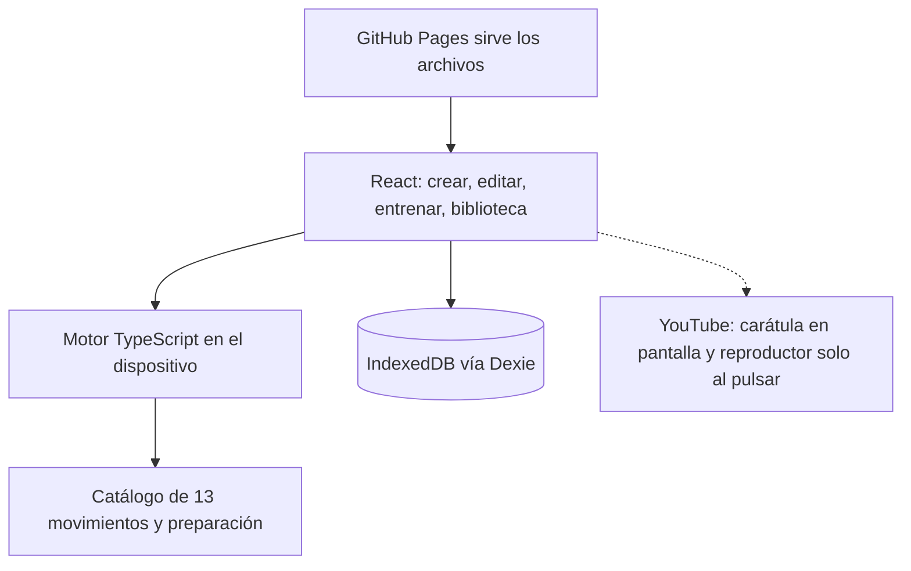
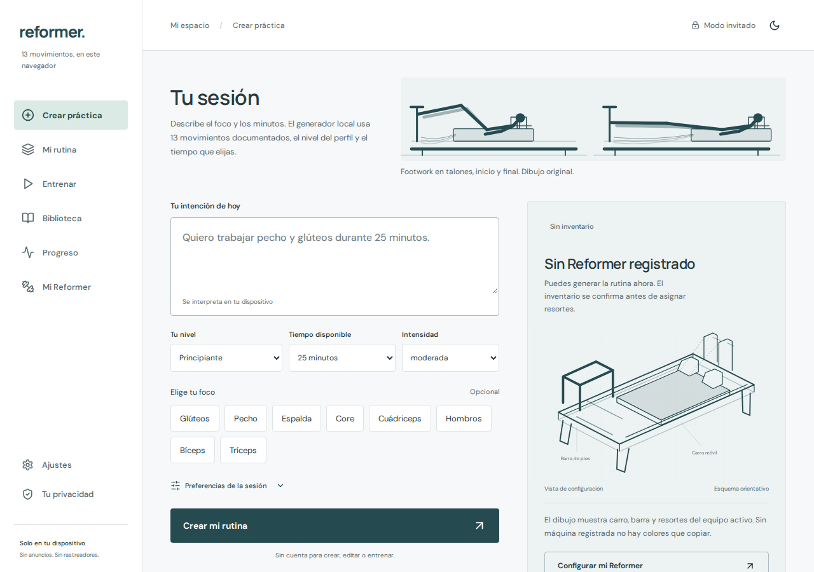
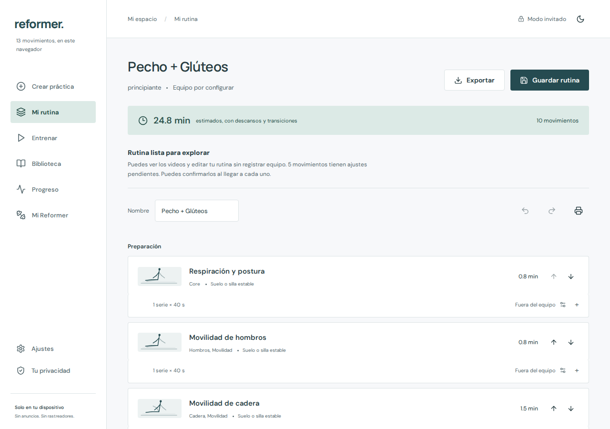
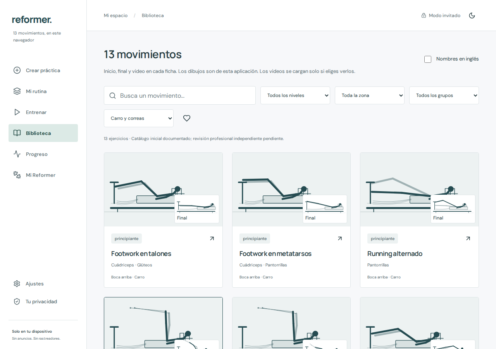

# REFORMER

Aplicación gratuita y privada para armar, editar y registrar una práctica de Pilates Reformer en el navegador. No hay servidor propio, cuenta, anuncios, suscripción ni llamada a una API de IA.

**Aplicación:** https://eflores1122.github.io/reformer/
**Código:** https://github.com/Eflores1122/reformer

## English summary

REFORMER is a free, private progressive web app for planning and logging a Pilates reformer practice. A local rules engine turns a short Spanish request into a draft from a catalog of 13 documented movements, plus a short preparation and a cool-down. You can edit sets, rests, and order, confirm the spring setup for your own machine, and record the sets you actually do. Profile, machines, the working draft, and sessions stay in IndexedDB on that browser. YouTube is used only for optional public demonstrations. The app does not give medical advice, diagnose, or prescribe spring loads. The repository ships no user histories and no usage metrics. License: MIT.

## Problema

Preparar una práctica de Reformer suele mezclar un catálogo ajeno, la memoria del inventario de resortes y un registro que no queda en el aparato. REFORMER separa esas tres cosas en el navegador: una propuesta editable, el inventario que tú confirmas para tu máquina y el historial de lo que registraste. La primera pantalla es el creador, con el esquema de Footwork y la fila de los 13 movimientos.

## Qué incluye esta versión

Versión funcional 0.1.3.

- Generador local en español, sensible a nivel, grupos, tiempo, equipo, accesorios y exclusiones.
- Editor con series, repeticiones, tiempos, descansos, transiciones, orden, notas, sustitución, deshacer, rehacer e impresión o PDF del navegador.
- Trece movimientos de Reformer con instrucciones propias, dibujo original de inicio y final, y un video público de Align-Pilates, Balanced Body o Pilates Anytime. El reproductor se carga solo al elegir reproducir.
- Varias máquinas con inventarios separados. El perfil Allegro 2 parte de la ficha pública del modelo (3 rojos, 1 azul, 1 amarillo) y de los nombres cualitativos de la ficha Signature Springs. El inventario IRONSIDE queda vacío hasta que lo escribes, porque el fabricante no publica cantidades ni fuerzas por color.
- Confirmación de ajustes por máquina y ejercicio. No hay receta automática de colores ni equivalencias en kilogramos.
- Entrenamiento con reloj por marcas temporales, pausa, series registradas, omisiones y reanudación.
- Historial, actividad semanal y una comparación local de esfuerzo dentro de la misma máquina y la misma configuración. Los resortes no cambian solos.
- IndexedDB, exportación de rutina JSON, respaldo completo JSON, historial CSV y restauración validada.
- PWA con shell instalable, tema claro u oscuro y rutas por fragmento (`#crear`, `#rutina`, …).

El borrador y los registros son locales. «Guardar rutina» explica que la biblioteca de cuenta y la sincronización aún no están configuradas, y ofrece exportar. Esta versión conserva un borrador de trabajo a la vez. Puedes exportar tantas rutinas como quieras.

## Qué no hace

No es consejo médico, no valora tu estado de salud y no prescribe rehabilitación ni cargas. Las notas de movimiento piden aprender la entrada, la salida y los ajustes con un instructor, y detenerte si algo no va bien. Una solicitud que menciona dolor, lesión, rehabilitación, embarazo u osteoporosis no recibe una rutina de Reformer. Las modificaciones escritas en el perfil también dejan fuera el aparato y se quedan en una preparación en el suelo.

Los dibujos son esquemas originales para reconocer la posición. No sustituyen una demostración ni el ajuste de un instructor. Los videos no se descargan ni se prometen sin conexión.

## Arquitectura

No hay backend. Vite empaqueta la interfaz, el catálogo y el motor. Dexie guarda un snapshot en IndexedDB y Zod valida lo que se importa. Workbox precarga el shell para GitHub Pages bajo `/reformer/`.



## Stack

- TypeScript estricto, React 19 y Vite 7
- Zod para respaldos e importaciones; Dexie para IndexedDB
- vite-plugin-pwa y Workbox
- Fuentes Manrope y DM Sans, OFL, empaquetadas en la aplicación
- Vitest, Playwright, axe-core y ESLint
- Node.js 24 o superior. El paquete npm está marcado como `private` y no se publica en el registro

## Inicio rápido

```sh
npm ci
npm run dev
```

Abre `http://127.0.0.1:5173/reformer/`. No hace falta `.env` ni credencial.

```sh
npm run lint
npm test
npm run build
npx playwright install chromium
npm run test:e2e
npm run preview
```

En macOS, Playwright usa Google Chrome en su ruta estándar. En Linux y en CI usa el Chromium de Playwright.

Para repetir las capturas de este README, con el build ya generado y Chromium instalado:

```sh
npm run screenshots
```

Ese comando levanta el preview, abre un perfil vacío y guarda tres PNG en `docs/screenshots/`.

## Ejemplo de salida

El generador, con el perfil por defecto y sin máquina registrada, respondió así a «Quiero 25 minutos de pecho y glúteos para principiantes». Los identificadores se omiten. Las series ajustan la duración pedida; no son una carga de resortes ni una recomendación para una persona.

```json
{
  "title": "Pecho + Glúteos",
  "level": "principiante",
  "targets": ["Pecho", "Glúteos"],
  "minutesRequested": 25,
  "plannedMinutes": 24.8,
  "warnings": [
    "Propuesta preliminar: configura tu equipo y confirma los ajustes de cada ejercicio antes de entrenar."
  ],
  "items": [
    { "phase": "Preparación", "name": "Respiración y postura", "sets": 1, "seconds": 40 },
    { "phase": "Preparación", "name": "Movilidad de hombros", "sets": 1, "seconds": 40 },
    { "phase": "Preparación", "name": "Movilidad de cadera", "sets": 1, "seconds": 40, "sides": 2 },
    { "phase": "Preparación", "name": "Movilidad de tobillos", "sets": 1, "seconds": 40, "sides": 2 },
    { "phase": "Práctica", "name": "Puente con carro estable", "sets": 4, "reps": 8, "seconds": 45 },
    { "phase": "Práctica", "name": "Footwork en talones", "sets": 4, "reps": 8, "seconds": 45 },
    { "phase": "Práctica", "name": "Footwork en metatarsos", "sets": 4, "reps": 8, "seconds": 45 },
    { "phase": "Práctica", "name": "Abrazo al árbol", "sets": 3, "reps": 8, "seconds": 45 },
    { "phase": "Práctica", "name": "Servir la bandeja", "sets": 2, "reps": 8, "seconds": 45 },
    { "phase": "Vuelta a la calma", "name": "Vuelta a la calma", "sets": 1, "seconds": 40 }
  ]
}
```

## Capturas

Tomadas el 12 de noviembre de 2026 desde `vite preview`, con un perfil vacío y movimiento reducido. No son maquetas.







## Pruebas

`npm test` ejecuta Vitest sobre el motor, los resortes y el almacenamiento (34 casos en la última ejecución local). `npm run test:e2e` recorre creación, equipo, biblioteca, sesión, exportación, PWA offline, viewports y axe-core en escritorio y en una emulación de iPhone 13. El detalle está en [docs/PRUEBAS.md](docs/PRUEBAS.md).

GitHub Actions (`.github/workflows/pages.yml`) ejecuta en Node 24, para `main` y para pull requests: `npm run lint`, `npm test`, `npm run build` y `npm run test:e2e`. La publicación en Pages solo ocurre fuera de un pull request.

## Estructura

```text
src/data/catalog.ts          ejercicios, fuentes y perfiles de máquina
src/data/videos.ts           identificadores públicos de YouTube
src/domain/engine.ts         interpretación, selección y duración
src/domain/springs.ts        inventario y validación de ajustes
src/domain/session.ts        reloj y registro de series
src/domain/storage.ts        IndexedDB, respaldo e importación
src/domain/schema.ts         entidades y esquemas Zod
src/components/              pantallas
src/App.tsx                  navegación y estado
tests/                       Playwright
docs/                        investigación, arquitectura, diseño, fuentes y límites
public/                      iconos de la PWA
```

## Accesibilidad

La interfaz está en español (`lang="es"`). Los controles de formulario van con etiqueta, la navegación principal y la móvil anuncian la página actual, y los diálogos usan `<dialog>` con título, cierre, tecla Escape y devolución del foco. Los botones de icono tienen nombre accesible. El anillo de foco es visible. `prefers-reduced-motion: reduce` anula animaciones y transiciones. El tema oscuro es un cambio de contraste, no un efecto de brillo.

axe-core, con las etiquetas WCAG 2.0 A/AA y 2.1 AA, no reportó infracciones en el creador en claro y oscuro, en escritorio y en móvil, ni en la biblioteca y el temporizador cubiertos por las pruebas. Eso no es una certificación ni sustituye una revisión manual con lector de pantalla. La auditoría con tecnología de asistencia sigue pendiente; está anotada en [docs/HOJA-DE-RUTA.md](docs/HOJA-DE-RUTA.md). Los videos tienen instrucciones escritas y un dibujo si el reproductor no carga. El audio de las demostraciones está en inglés y los subtítulos dependen del autor.

## Privacidad

Los datos de la práctica no salen del navegador salvo que exportes un archivo o abras un enlace. No hay analítica, anuncios ni rastreadores propios. GitHub Pages puede registrar datos técnicos de acceso. La carátula de un video se pide a YouTube cuando la ficha está en pantalla; el iframe de `youtube-nocookie` se inserta solo al pulsar reproducir. La voz, si la activas, usa el sintetizador del sistema y puede ser remota. Desde Ajustes puedes exportar, restaurar o borrar lo guardado. El detalle está en [PRIVACY.md](PRIVACY.md) y en el diálogo «Tu privacidad» de la aplicación.

## Datos de este repositorio

No hay historiales de usuarios, datos de clientes, métricas de uso ni secretos. Lo que ves al abrir la aplicación es un perfil vacío y un borrador vacío. El catálogo son notas originales de este repositorio, con la fuente pública citada en [docs/FUENTES.md](docs/FUENTES.md); los manuales no se redistribuyen. Las cantidades del Allegro 2 salen de la ficha pública del fabricante. El IRONSIDE no trae un inventario inventado. Los valores de las pruebas de interfaz sirven para comprobar controles; no son una prescripción de ejercicio. Cualquier sesión que crees permanece en tu navegador.

## Limitaciones

- Un solo borrador local. No hay cuenta, OAuth ni sincronización.
- Trece fichas de Reformer, no un catálogo completo. Si no hay un movimiento compatible, la duración real puede ser más corta y se avisa.
- El analizador cubre patrones explícitos en español, no cualquier frase.
- La comparación de progreso no cambia resortes ni diagnostica recuperación.
- La traducción completa de la interfaz al inglés está pendiente.
- No hay revisión profesional independiente ni búsqueda exhaustiva de marca. REFORMER es un nombre descriptivo de este proyecto. No hay afiliación con los fabricantes o las aplicaciones que aparecen como fuente.

Más detalle en [docs/HOJA-DE-RUTA.md](docs/HOJA-DE-RUTA.md).

## Publicación

GitHub → Settings → Pages → Source: **GitHub Actions**. Vite, el manifest y el service worker usan `/reformer/`. Si cambia el nombre del repositorio, actualiza la base en `vite.config.ts` y los recursos de `index.html`. Una actualización del service worker no recarga una práctica en curso. Los recursos externos no se prometen offline.

## Documentación

- [Investigación funcional y matriz](docs/INVESTIGACION.md)
- [Arquitectura y diccionario de datos](docs/ARQUITECTURA.md)
- [Diseño y movimiento](docs/DISENO.md)
- [Fuentes y revisión](docs/FUENTES.md)
- [Validación y casos de aceptación](docs/PRUEBAS.md)
- [Limitaciones y hoja de ruta](docs/HOJA-DE-RUTA.md)
- [Privacidad](PRIVACY.md), [contribución](CONTRIBUTING.md), [cambios](CHANGELOG.md), [medios](CREDITS.md), [atribuciones](THIRD_PARTY_NOTICES.md)

## Licencia

Código e ilustraciones originales bajo [MIT](LICENSE). Fuentes tipográficas bajo OFL y dependencias bajo sus propias licencias, listadas en [THIRD_PARTY_NOTICES.md](THIRD_PARTY_NOTICES.md). Los manuales enlazados no se redistribuyen.
